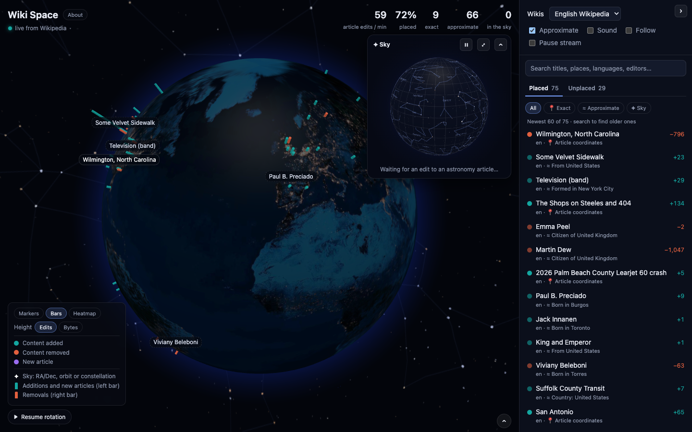

# Wiki Space

Live (non-bot) edits to Wikipedia articles, shown on a 3D globe as they happen!

> [!IMPORTANT]
>
> Inspired by Hatnote's [Listen to Wikipedia](https://listen.hatnote.com/).



## Run it

It's a static site with no build step. Serve the folder with any web server (opening `index.html` as a file won't work, because browsers only load JavaScript modules from a server):

```bash
git clone https://github.com/lbeckman314/wiki-space.git

cd wiki-space

python3 -m http.server 8000
```

> [!TIP]
>
> Edits to astronomy articles (stars, galaxies, planets, asteroids) appear on a separate sky map.
>
> Astronomy edits are rare. To see the sky map straight away, simulate edits to chosen articles (this only reads from Wikipedia and Wikidata):
>
> ```
> http://localhost:8000/?simulate=Andromeda Galaxy|Betelgeuse|Mars
> ```

## Credits and data

| What | Source | License |
|---|---|---|
| Live edits | [Wikimedia EventStreams](https://wikitech.wikimedia.org/wiki/Event_Platform/EventStreams) | Wikimedia terms of use |
| Article coordinates and summaries | Wikipedia (MediaWiki and REST APIs) | Text: CC BY-SA 4.0 |
| Places, sky coordinates and orbits | [Wikidata](https://www.wikidata.org/) | CC0 |
| 3D globes | [globe.gl](https://github.com/vasturiano/globe.gl), built on three.js | MIT |
| Earth images | three-globe example images, based on NASA imagery | See three-globe |
| Stars and constellations | [d3-celestial](https://github.com/ofrohn/d3-celestial) data | BSD-3-Clause |
| Planet positions | [Astronomy Engine](https://github.com/cosinekitty/astronomy) | MIT |
| Inspiration | [Listen to Wikipedia](https://listen.hatnote.com/) by Hatnote | – |
