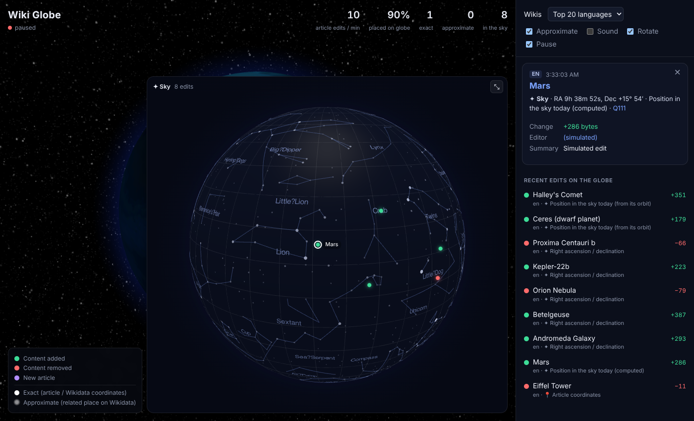

# Wiki Space

Live, non-bot edits to Wikipedia articles, shown on a 3D globe as they happen. Edits to astronomy articles (stars, galaxies, planets, asteroids) appear on a separate sky map.




## Run it

It's a static site with no build step. Serve the folder with any web server:

```bash
python3 -m http.server 8000
```

Then open http://localhost:8000.

Astronomy edits are rare, so to see the sky map straight away you can simulate edits to chosen articles. This only reads Wikipedia and Wikidata; nothing is written:

```
http://localhost:8000/?simulate=Andromeda Galaxy|Betelgeuse|Ceres (dwarf planet)|Mars|Halley's Comet
```

You can also run `__wikiGlobe.simulate('Orion Nebula')` in the browser console. Pass a location to skip the lookup entirely, which is handy for testing without any network requests:

```js
__wikiGlobe.simulate('Test edit', 'en', { lat: 48.86, lng: 2.29 })
__wikiGlobe.simulate('Test star', 'en', { sky: true, ra: 88.79, dec: 7.41 })
```

## Controls

- **Approximate**: show or hide edits placed through a related place on Wikidata.
- **Sound**: play a note for each edit.
- **Points**: draw edits as numbered markers (clusters with counts) or as a thin heatmap. In heatmap mode, click the Earth to open the newest edit near that spot. The heatmap is refreshed at most every 8 seconds and is drawn from cluster totals, so it stays affordable in browsers without WebGPU, where three-globe computes it on the CPU. The choice is remembered in the browser.
- **Follow**: turn each globe to its newest edit, at most once every 1.5 seconds (when edits arrive faster, it catches up with the latest one). Rotation pauses while Follow is on, and the camera stays put while a detail card is open.
- **Pause stream**: disconnect from the live stream.
- **Pause rotation** buttons: one at the bottom of the Earth view and one in the sky map's header, so each globe can be stopped separately.
- **Placed / Unplaced** tabs: placed edits, and edits that couldn't be placed, with the reason (no coordinates or related place, or a location on the surface of another body).
- **Search** (top of the sidebar): finds edits recorded this session by title, place, language or editor, ignoring accents and letter case. It covers everything recorded, not just the rows on screen, and combines with the tabs and the **All / Exact / Approximate / Sky** filters. Esc clears it.
- **Stats** at the top right: click placed, exact, approximate or in the sky to list those edits in the sidebar.
- **Sidebar / Sky map / Timeline** buttons under the title show or hide each panel, and the choice is remembered in the browser. A hidden sky map stops drawing. Opening an edit's card shows the sidebar again.
- **About** (`about.html`): how it works, how it was built, how to run and deploy it, and credits.
- Click a marker, a floating title or an entry in a list to open the detail card.

### Timeline

Every edit placed since the page opened is kept in memory (up to 50,000). The bar at the bottom of the globe replays them:

- **Track:** shows how many edits were placed over time. Click or drag it to move the playhead. The globes then show the 10 minutes of edits before that moment, and the sky map shows only edits made by then.
- **Play / pause:** pausing while live freezes the view at that moment. Playing replays from the playhead at the chosen speed (1× to 3600×). Edits get their ripple, title, sound and Follow as the playhead passes them; at high speeds only some get ripples. Playback switches back to live when it reaches the present.
- **Jump to start** and **Live** buttons. With the track focused, ← and → move ±1 minute, Shift moves ±10 minutes, and Home and End jump to the start and to live.
- New edits keep being recorded while you replay. Edits are placed at the time they were made, not when their location lookup finished.

The recording lasts only as long as the page is open. For a full day or week, a small server could read the stream continuously and store compact records. The stream itself can replay roughly the last two weeks (`?since=`), but that means downloading every edit on every Wikimedia site, so it isn't practical from a browser.

To try the timeline without waiting, backdate simulated edits in the console:

```js
for (let i = 0; i < 60; i++) __wikiGlobe.simulate('Edit ' + i, 'en', { lat: 48.86, lng: 2.35 + i * 0.3, time: Date.now() - (60 - i) * 30e3 })
```

### Markers

Edits close together are merged into one marker showing a count. "Close" is a grid cell whose size follows the zoom, so clusters split apart as you zoom in. Markers keep a constant size on screen, grow with the number of edits they hold, and are coloured by their newest edit. Exact and approximate edits are never merged together. Approximate edits sit exactly on their place, so, for example, all edits placed at "United States" form one marker. Clicking a marker opens its newest edit, and the card lists the other edits in it.

## How it works

```
EventStreams (SSE) ─► filter: article namespace, edit/new, not a bot, *.wikipedia.org
        │
        ▼
geo.js  resolveLocation(server, title)
  1. Wiki API, batched up to 50 titles:  prop=coordinates|pageprops
       └─ article has coordinates        → exact
  2. Wikidata, batched up to 50 ids:      wbgetentities (claims)
       ├─ P625 coordinate location        → exact
       ├─ sky (see below)                 → sky map
       └─ first place found along the chain, then that place's P625:
            P276 location · P131 admin area · P159 HQ · P740 formed in   → "place"
            P19 born in · P20 died in                                     → "person"
            P17 country · P495 country of origin · P27 citizenship        → "country"
        │
        ▼
sky   Sun, Moon and planets          → astronomy-engine, position today
      P6257 RA + P6258 Dec              → exact (stars, galaxies, nebulae, exoplanets)
      orbital elements P2233 a, P1096 e, P2045 i, P2213 Ω, P2248 ω, P2325 M, epoch P6259
                                        → Kepler's equation → RA/Dec as seen from Earth today
      P59 constellation only            → approximate, at the constellation's centre
        │
        ▼
app.js  globe.gl: ripples (size = edit size), dots that fade over 10 minutes,
        floating titles, a list of recent edits, a detail card (REST summary + diff link)
sound.js  optional Web Audio: larger edits play lower notes, panned by longitude
```

- **Exact** locations are drawn as solid markers with sharp ripples. **Approximate** ones are faint markers with wide, slow ripples.
- On the sky map, longitude is −RA and latitude is Dec. RA is negated so constellations read like a sky chart rather than a mirror image. The orbit calculation ignores perturbations and light-time; for Mars it agrees with astronomy-engine to within about 0.03°.
- Surface features on other bodies, such as lunar craters, are counted and skipped. A body that has a sky position (the Moon, Mars) is shown on the sky map.
- The starry background behind the Earth is painted from the same star catalogue as the sky map (stars to magnitude 6, coloured by B−V colour index, with faint constellation lines). It isn't rotated to match the real sky above each point on Earth.
- Every lookup is cached, and places such as cities and countries are cached permanently, so request volume drops as the cache fills.
- The site sends at most 3 requests at a time. On HTTP 429, or a network error (a rate-limit reply without CORS headers looks like one to the browser), every request pauses for the server's `Retry-After` time or an exponential backoff, and the status line shows that lookups are being rate-limited.

## Files

| File | Purpose |
|---|---|
| `index.html` | Page layout; loads globe.gl 2.45.3 from jsDelivr |
| `style.css` | Styles, including the mobile layout (bottom panel under 760px wide) |
| `geo.js` | Location resolver: batching, caching, Wikidata fallback chain, rate limiting |
| `app.js` | Stream, globe layers, ticker, card, stats, controls |
| `sky.js` | Sky map (a second globe.gl globe) plus the astronomy helpers. Star catalogue and constellation data come from d3-celestial (BSD-3-Clause) |
| `sound.js` | Sound |

## Ideas for next steps

- Let users toggle each fallback tier on or off, or show tiers in different colours.
- Run a small relay (Cloudflare Worker or Node) that reads the stream once, resolves locations server-side and pushes them to clients. That keeps request volume to Wikimedia flat however many people are watching.
- Add an "edits per region in the last hour" heat layer (globe.gl `hexBinPointsData`).
- Rotate the camera toward large edits automatically.
